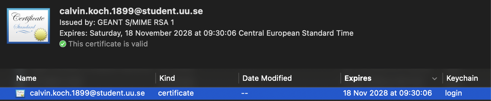

# Lab 1: Secure Computer Systems

**Date:** 19.11.2026
**Author:** Calvin Koch
**Course:** Secure Computer Systems I (1DT072, 11209, HT2026)
**Lab title:** Lab 1 - Secure Computer Systems
**Collaboration:** I worked independently.

Screenshots in the report itself have been avoided where possible. The
appendix contains only selected screenshots as supporting evidence; the
findings can be understood from the written explanations.

This report presents the required exercises for Lab 1. The higher-grade
exercises are submitted separately.

## Task 1: SQL Injections

### 1.1 Basic SQL Injection

* **Target field:** Login email field
* **Injection payload:** `admin@juice-sh.op' or 1=1--`
* **Result:** I was logged in as the administrator without entering the correct
  password.

The input changes the SQL query instead of being treated only as an email
address. The quote closes the original email string. `or 1=1` is always true,
and `--` comments out the rest of the query, including the password check.
This is SQL injection: input from a user becomes part of the SQL command.

### 1.2 Authentication Bypass

* **Target user:** A user other than the administrator
* **Payload:** `' or 1=1 and email like('%user%');--`
* **Result:** The query returned a matching user and the application logged me
  in as that user without a valid password.

The `LIKE` part limits the result to an email containing the selected word.
The final comment removes the remaining password comparison. The exact result
depends on which user name is used and which row the application returns.

### 1.3 Prevention Strategies

The main fix is to use parameterized queries or prepared statements. The SQL
command should be compiled separately from the value supplied by the user.
Then a value such as `' or 1=1--` stays a text value and cannot change the
query. Input validation is useful as an additional measure, but it should not
be the only defence. Input should also be escaped or encoded in the correct
context, so special characters are treated as text and not as part of the
statement. For example, an input such as `' or 1=1--` must remain a value and
not become SQL syntax. The database account should also have only the
permissions it needs.

### 1.4 “Little Bobby Tables” Comic Analysis

Bobby’s name contains `Robert'); DROP TABLE Students;--`. If the school
creates an SQL command by joining strings, the first quote ends the original
name. The closing parenthesis and semicolon finish the original command.
`DROP TABLE Students;` is then a second command that deletes the whole table.
The final `--` comments out any remaining characters.

The school should use prepared statements and restore the table from a
backup. The database account used by the application should not be allowed to
drop tables. This is the principle of least privilege: a normal insert
operation should not also have permission to destroy the database structure.

## Task 2: XSS/CSRF

### 2.1 Cross-Site Scripting

I used an iframe payload that reads the logged-in user’s email from
`localStorage`:

```html
<iframe srcdoc="
    <h1>This is XSS injection Attack</h1>
    <p>This is inside the iframe.</p>
    <script>
        let email = localStorage.getItem('email');
        console.log('User email:', email);
    </script>
    <p>This is the users email: <span id='user-email'></span></p>
    <script>
        document.getElementById('user-email').textContent = email;
    </script>
"></iframe>
```

To reproduce the attack, log in to Juice Shop and open the vulnerable search
field. Enter the payload exactly as shown above and submit the search. Open
the resulting page while still logged in. The page displays the email stored
in the browser. The attack works because the
application places HTML supplied by the user into the page without safely
encoding it. The browser then treats the iframe and its JavaScript as part of
the trusted page. This is the type of injection described by OWASP
[@owasp_xss].

The email is not especially sensitive on its own, but the same technique could
read other information stored in browser storage. In a real attack, the script
could send the value to an attacker-controlled server using a request for an
invisible image. The server could return the same one-pixel image while
recording the value in its request log. The user would see no visible
indication that the data had been sent.

### 2.2 XSS vs. CSRF

XSS abuses the user’s trust in a website. The user visits a real website, but
the website includes an attacker’s script and the browser executes it.

CSRF abuses the website’s trust in the user’s browser. A different website
tricks the browser into sending a state-changing request to a site where the
user is already logged in. The browser attaches the session cookie, so the
server can mistake the forged request for a normal request from the user
[@owasp_csrf].

The important difference is who is being deceived: XSS makes the browser run
attacker code in the trusted site, while CSRF makes the trusted site accept a
request that the user did not intend to send.

## Task 3: Authentication

### 3.1 XKCD Password Generator

The program is in [`xkcd_pass.py`](xkcd_pass.py). It reads a word list, chooses
the requested number of random words, and calculates

`entropy = number_of_words * log2(number_of_words_in_wordlist)`.

It also divides the entropy by `log2(62)` to estimate how many random
characters from `[a-z, A-Z, 0-9]` would give the same entropy. This uses the
information-theory idea described by Shannon [@shannon1948]. The word choices use
Python’s `secrets` module.

Example format:

```text
redemise underking combmaker embark
4 RANDOM words from word list of 234936 words
Entropy: 71.37 bits
You need 11.99 RANDOM characters in [a-z, A-Z, 0-9] to get the same entropy.
```

The exact words and word-list size can differ between systems.

The first line is the generated password. The second line says how many words
were selected and how many usable words were found in the word list. The third
line is the calculated entropy. The last line converts that entropy into the
equivalent number of random characters from an alphabet of 62 characters.
These numbers describe a uniformly random selection; a password made from
predictable words would have less real-world entropy.

The complete program is included in Appendix A. It first imports the
modules, reads and filters `/usr/share/dict/words`, and uses `secrets.choice`
to select the words. It then calculates the entropy and prints the four result
lines. The final block reads the number of words from the command line or asks
for it and reports an invalid integer instead of crashing.

### 3.2 Shoulder Surfing Entropy

I assume that the user can only type characters from `[a-z, A-Z, 0-9]`.
Shift is used only to turn a lowercase letter into an uppercase letter, not to
type special characters. If more key options are allowed, the same method
still applies but the number of possibilities changes. I assume an alphabet of
lowercase letters and digits when Shift is not used:
36 possibilities. When Shift is used, I assume it means an uppercase letter:
26 possibilities.

The attacker knows that 3 of the 10 positions use Shift. The remaining
possibilities are therefore

$\binom{10}{3} \cdot 26^3 \cdot 36^7$.

The entropy is

$\log_2\left(\binom{10}{3} \cdot 26^3 \cdot 36^7\right) \approx 57.1$
bits.

This is lower than not knowing anything about the Shift positions because the
attacker has learned part of the password structure.

### 3.3 S/MIME Secure Email

I took screenshots while creating the certificate, importing it, signing an
email, and sending an encrypted email. They are collected in the appendix.
The issuer and validity dates are:
Issued by: GEANT S/MIME RSA 1
Expires: Saturday, 18 November 2028 at 09:30:06 Central European Standard Time

Before encrypted mail can be sent, the sender needs the recipient’s public
key. A signed email lets the recipient’s client receive and verify the
sender’s public certificate. After the keys have been exchanged, the clients
can encrypt messages for each other.

Thunderbird or another local mail client is more suitable than webmail because
the private key can stay on the local computer. With ordinary webmail, the
provider controls the page and may also control the key-handling process. This
makes it harder to guarantee end-to-end encryption.

S/MIME uses public-key cryptography for exchanging keys and normally uses
symmetric encryption for the email content. Public-key systems such as RSA
rely on mathematical problems involving large prime numbers: multiplying two
large primes is easy, while recovering the primes from their product is much
harder. The public key can therefore be shared, while the private key is kept
secret. In practice, trying to break a properly sized key by brute force is
not a realistic way to decrypt the message [@nist80057].

## Task 4: Access Control

### 4.1 Program and experiment procedure

The automated shell script includes the Python program used for the
experiment. It creates the target directory, opens
`tocttou/temp_file.txt` for writing, pauses for input, writes through the
already-open file object, closes it, and reports errors. The script first
selects an unbuffered Python command so that the pause appears immediately. It
then sets the target directory and file names and defines a helper that prints
the file after each test. It creates the Python test program, creates the
target file, and runs four cases:

1. **Normal run:** the file is given write permission. The Python program
   opens it, the shell makes no changes during the pause, and the program
   writes its test line.
2. **Permission change:** the file starts with write permission. During the
   pause, the shell runs `chmod u-w` and then sends Enter. The Python process
   still writes using the file it already opened.
3. **No permission at open time:** the file remains without write permission
   from the previous test. The Python program tries to open it and reports the
   error before it can reach the write step.
4. **Deletion:** write permission is restored before opening. During the pause,
   the shell removes the directory entry and then sends Enter. The already-open
   file can still be written, but the path no longer points to it.

The script prints the permissions before each test, prints the shell action
performed during the pause, and prints the resulting file content afterwards.
It removes the temporary Python file and test directory at the end.

### 4.2 Results and comparison

The screenshots are collected in Appendix B. In the first macOS test, the
permission line shows that writing is allowed before the program starts. The
shell then makes no change, so the file contains the line written by Python.

In the second test, the permission output changes after `chmod u-w`. Even
though the path no longer has the write bit, Python has already opened the file
and its open file descriptor still refers to the file. The write therefore
completes. This demonstrates the difference between checking permissions when
opening a file and using a file that has already been opened.

In the third test, the file has no write permission before Python opens it.
This time the open operation itself fails, so there is no valid descriptor on
which Python can perform the later write.

In the deletion test, the shell removes the file name during the pause. On
macOS, removing a directory entry does not immediately invalidate an existing
file descriptor. Python can therefore finish writing, but the later path-based
read cannot find the file because its name has been removed.

The Windows screenshots show different behaviour for the same general
experiment. Windows uses file-sharing rules when a handle is created, so a
file that is open by Python can prevent deletion or cause a later operation to
fail [@microsoft_createfile]. Unix-like systems normally allow an open file to
remain usable after its directory entry has been removed. POSIX specifies that
the file contents are kept until all open references are closed
[@posix_unlink]. The difference comes from the operating system’s file and
descriptor semantics, not from a different Python program.

### 4.3 Plain-English description of the Python program

The embedded Python program imports `sys`, receives the target path, and
pauses after opening the file. It writes one line after the pause and closes
the file. The exception handler prints any error instead of hiding it. The
shell script creates the directory, performs the permission and deletion
changes, prints the results, and removes the temporary files at the end.

The race condition is between opening or checking the file and using it later.
The file system state can change during that pause. Opening the file first
reduces the effect of later path changes because the descriptor refers to the
opened object, but it does not make every later operation safe.

## Appendix A: XKCD password program

```python
import math
import secrets
import sys

def generate_password(num_words):
    # Load the native Unix/macOS dictionary
    wordlist_path = '/usr/share/dict/words'
  
    with open(wordlist_path, 'r') as file:
        # Strip whitespace and filter to only alphabetical words to avoid punctuation
        words = [word.strip().lower() for word in file if word.strip().isalpha()]
  
    wordlist_size = len(words)
  
    # Use the secrets module for random selection
    password_words = [secrets.choice(words) for _ in range(num_words)]
    password = " ".join(password_words)
  
    # Calculate entropy
    # Entropy = (Number of Words) * log2(Size of Wordlist)
    entropy = num_words * math.log2(wordlist_size)
  
    # Calculate equivalent random characters
    # [a-z, A-Z, 0-9] = 26 + 26 + 10 = 62 possible characters
    # Required Chars = Total Entropy / log2(62)
    char_alphabet_size = 62
    equiv_chars = entropy / math.log2(char_alphabet_size)
  
    # Output the results
    print(f"\n{password}")
    print(f"{num_words} RANDOM words from word list of {wordlist_size} words")
    print(f"Entropy: {entropy:.2f} bits")
    print(f"You need {equiv_chars:.2f} RANDOM characters in [a-z, A-Z, 0-9] to get the same entropy.\n")

if __name__ == "__main__":
    try:
        num = int(sys.argv[1]) if len(sys.argv) > 1 else int(input("Enter number of words: "))
        generate_password(num)
    except ValueError:
        print("Please provide a valid integer.")
```

## Appendix B: TOCTTOU automated test script

```bash
#!/bin/bash

# Ensure unbuffered python output (-u) so prints appear immediately before the pause
if python3 --version &>/dev/null; then
    PY_CMD="python3 -u"
else
    PY_CMD="python -u"
fi

TARGET_DIR="tocttou"
TARGET_FILE="$TARGET_DIR/temp_file.txt"
PY_SCRIPT="tocttou_app.py"

# Helper function to print file content
print_file_content() {
    echo "[After] Reading file content:"
    echo "---"
    if [ -f "$TARGET_FILE" ]; then
        cat "$TARGET_FILE"
    else
        echo "File does not exist or cannot be read."
    fi
    echo "---"
}

cat << 'EOF' > "$PY_SCRIPT"
import sys

filepath = sys.argv[1]

# ANSI color codes for better terminal output
G = "\033[92m"   # Light Green
RED = "\033[91m" # Light Red
R = "\033[0m"    # Reset back to default

try:
    print(f"{G}[*] Python: Opening '{filepath}' for writing...{R}")
    fd = open(filepath, "w")
  
    print(f"{G}[!] Python: Paused. (Bash is performing TOCTTOU modifications...) Press Enter...{R}")
    input()
  
    print(f"{G}[*] Python: Writing to file descriptor...{R}")
    fd.write("This Data was written during the TOCTTOU test.\n")
    fd.close()
    print(f"{G}[+] Python: File closed successfully.\n{R}")
except Exception as e:
    print(f"{RED}[-] Python Error: {e}\n{R}")
EOF

mkdir -p "$TARGET_DIR"

echo "========================================================"
echo "Test 1: Normal execution (Write permissions allowed) "
echo "========================================================"
touch "$TARGET_FILE"
chmod u+w "$TARGET_FILE"
echo "[Before] Permissions:"
ls -l "$TARGET_FILE"
(
    sleep 1
    # >&2 redirects Bash prints to the terminal so they don't get sent to Python's input
    echo ">>> [Bash Action] No modifications made during pause." >&2
    echo "Sending enter key..." >&2
    echo ""
) | $PY_CMD "$PY_SCRIPT" "$TARGET_FILE"
print_file_content


echo -e "\n========================================================"
echo " Test 2: Revoke write permissions during TOCTTOU pause "
echo "========================================================"
# Recreate/clear file for a fresh test and ensure write permissions are granted
echo -n > "$TARGET_FILE"
chmod u+w "$TARGET_FILE"
echo "[Before] Permissions:"
ls -l "$TARGET_FILE"
(
    sleep 1
    echo ">>> [Bash Action] Revoking write permissions (chmod u-w)..." >&2
    chmod u-w "$TARGET_FILE"
    ls -l "$TARGET_FILE" >&2
    echo "Sending enter key..." >&2
    echo ""
) | $PY_CMD "$PY_SCRIPT" "$TARGET_FILE"
print_file_content


echo -e "\n========================================================"
echo " Test 3a: Run without write permissions from the start "
echo "========================================================"
echo "[Before] Permissions (Should still be revoked from Test 2):"
ls -l "$TARGET_FILE"
(
    sleep 1
    echo ">>> [Bash Action] Sending enter key..." >&2
    echo "" 
) | $PY_CMD "$PY_SCRIPT" "$TARGET_FILE"
print_file_content


echo -e "\n========================================================"
echo " Test 3b: Delete the file during TOCTTOU pause         "
echo "========================================================"
# Give write permissions back before starting
chmod u+w "$TARGET_FILE"
echo "[Before] Permissions:"
ls -l "$TARGET_FILE"
(
    sleep 1
    echo ">>> [Bash Action] Deleting the file (rm)..." >&2
    rm "$TARGET_FILE" 2>/dev/null || echo ">>> [Bash Action] Failed to delete file (OS Locked File)" >&2
    ls -l "$TARGET_FILE" 2>&1 >&2
    echo "Sending enter key..." >&2
    echo ""
) | $PY_CMD "$PY_SCRIPT" "$TARGET_FILE"
print_file_content


# Cleanup
echo -e "\n[*] Cleaning up environment..."
rm -f "$PY_SCRIPT"
rm -rf "$TARGET_DIR"
```

## Appendix C: Selected evidence screenshots

The terminal output and permission changes are described in the report instead
of being reproduced as full-page screenshots. The following screenshots show
the certificate details and the signed and encrypted email results.





## References
