# Lab 1: Secure Computing

**Author:** Calvin Koch
**Date:** 19.11.2026

This report contains the normal exercises. The higher-grade exercises are in
[`report-1-final-HG.md`](report-1-final-HG.md). Sources, quotations, and links
are kept separately in [`references.md`](references.md).

## Task 1: SQL Injections

### 1.1 Basic SQL Injection (Exercise 1)

* **Target field:** Login email field
* **Injection payload:** `admin@juice-sh.op' or 1=1--`
* **Result:** I was logged in as the administrator without entering the correct
  password.

The input changes the SQL query instead of being treated only as an email
address. The quote closes the original email string. `or 1=1` is always true,
and `--` comments out the rest of the query, including the password check.
This is SQL injection: input from a user becomes part of the SQL command.

### 1.2 Authentication Bypass (Exercise 2)

* **Target user:** A user other than the administrator
* **Payload:** `' or 1=1 and email like('%user%');--`
* **Result:** The query returned a matching user and the application logged me
  in as that user without a valid password.

The `LIKE` part limits the result to an email containing the selected word.
The final comment removes the remaining password comparison. The exact result
depends on which user name is used and which row the application returns.

### 1.3 Prevention Strategies (Exercise 3)

The main fix is to use parameterized queries or prepared statements. The SQL
command should be compiled separately from the value supplied by the user.
Then a value such as `' or 1=1--` stays a text value and cannot change the
query. Input validation is useful as an additional measure, but it should not
be the only defence. ** Lastly the input should be sanatized, meaning all the special characters should be marked as such so they are still interpreted as text and not as part of the statement (e.g. `' or 1=1--` will become `' or 1=1--`). The database account should also have only the
permissions it needs.

### 1.4 “Little Bobby Tables” Comic Analysis (Exercise 4)


Bobby’s name contains `Robert'); DROP TABLE Students;--`. If the school
creates an SQL command by joining strings, the first quote ends the original
name. The closing parenthesis and semicolon finish the original command.
`DROP TABLE Students;` is then a second command that deletes the whole table.
The final `--` comments out any remaining characters.

The school should use prepared statements and restore the table from a
backup. The database account used by the application should not be allowed to
drop tables. This is the least-privilege idea **source needed: a normal insert operation
should not also have permission to destroy the database structure.

## Task 2: XSS/CSRF

### 2.1 Cross-Site Scripting (Exercises 1–3)

I used an iframe payload that reads the logged-in user’s email from
`localStorage`:

```html
<iframe srcdoc="
    <h1>This is XSS injection Attack</h1>
    <p>This is inside the iframe.</p>
    <script>
        let email = localStorage.getItem('email');
        console.log('User email:', email);
    </script>
    <p>This is the users email: <span id='user-email'></span></p>
    <script>
        document.getElementById('user-email').textContent = email;
    </script>
"></iframe>
```

To reproduce it, you open the vulnerable Juice Shop search field, entered the
payload, submit it, and opened the resulting page while logged in. The
page displayes the email stored in the browser. The attack works because the
application places HTML supplied by the user into the page without safely
encoding it. The browser then treats the iframe and its JavaScript as part of
the trusted page. This is the type of injection described by OWASP [1].
**This is not very critical information but the the same concept applies to any other data stored in local storage/ chached in a browser.
** If we take this further the iformation could be sent to th hackers servers by sending an image request from a source, and as the source the script just sends the information to be leaked. The attackers website just replies with the same invisible 1px image each time while storing the information in the database without the user knowig that they leaked information. (adjust the wording if needed)
**reproduction reformulated so the prof can reproduce it

### 2.2 XSS vs. CSRF (Exercises 4–5)

XSS abuses the user’s trust in a website. The user visits a real website, but
the website includes an attacker’s script and the browser executes it.

CSRF abuses the website’s trust in the user’s browser. A different website
tricks the browser into sending a state-changing request to a site where the
user is already logged in. The browser attaches the session cookie, so the
server can mistake the forged request for a normal request from the user [2].

The important difference is who is being deceived: XSS makes the browser run
attacker code in the trusted site, while CSRF makes the trusted site accept a
request that the user did not intend to send.

## Task 3: Authentication

### 3.1 XKCD Password Generator (Exercises 1–10)

The program is in [`xkcd_pass.py`](xkcd_pass.py). It reads a word list, chooses
the requested number of random words, and calculates

`entropy = number_of_words * log2(number_of_words_in_wordlist)`.

It also divides the entropy by `log2(62)` to estimate how many random
characters from `[a-zA-Z0-9]` would give the same entropy. This uses the
information-theory idea described by Shannon [3]. The word choices use
Python’s `secrets` module.

Example format:

```text
redemise underking combmaker embark
4 RANDOM words from word list of 234936 words
Entropy: 71.37 bits
You need 11.99 RANDOM characters in [a-z, A-Z, 0-9] to get the same entropy.
```

**missing section: Explain the results. Explain line by line the output from above
Python Code Used: **Move to appendix and reference it here

```Python
import math
import secrets
import sys

def generate_password(num_words):
    # Load the native Unix/macOS dictionary
    wordlist_path = '/usr/share/dict/words'
  
    with open(wordlist_path, 'r') as file:
        # Strip whitespace and filter to only alphabetical words to avoid punctuation
        words = [word.strip().lower() for word in file if word.strip().isalpha()]
  
    wordlist_size = len(words)
  
    # Use the secrets module for random selection
    password_words = [secrets.choice(words) for _ in range(num_words)]
    password = " ".join(password_words)
  
    # Calculate entropy
    # Entropy = (Number of Words) * log2(Size of Wordlist)
    entropy = num_words * math.log2(wordlist_size)
  
    # Calculate equivalent random characters
    # [a-z, A-Z, 0-9] = 26 + 26 + 10 = 62 possible characters
    # Required Chars = Total Entropy / log2(62)
    char_alphabet_size = 62
    equiv_chars = entropy / math.log2(char_alphabet_size)
  
    # Output the results
    print(f"\n{password}")
    print(f"{num_words} RANDOM words from word list of {wordlist_size} words")
    print(f"Entropy: {entropy:.2f} bits")
    print(f"You need {equiv_chars:.2f} RANDOM characters in [a-z, A-Z, 0-9] to get the same entropy.\n")

if __name__ == "__main__":
    try:
        num = int(sys.argv[1]) if len(sys.argv) > 1 else int(input("Enter number of words: "))
        generate_password(num)
    except ValueError:
        print("Please provide a valid integer.")
```

The exact words and word-list size can differ between systems.

### 3.2 Shoulder Surfing Entropy (Exercises 11–13)

Assumptions: ** The User can only type from the following Characters: `[a-z, A-Z, 0-9]` and the shift key can only be used to make lowercase characters to uppercase not for special characters. For more key options the calculation principle stays the same but more key options and combinations could be pressed.
I assume an alphabet of lowercase letters and digits when Shift is not used:
36 possibilities. When Shift is used, I assume it means an uppercase letter:
26 possibilities.

The attacker knows that 3 of the 10 positions use Shift. The remaining
possibilities are therefore

`C(10,3) * 26^3 * 36^7`. **use the scientific writing fro C(10,3)

The entropy is

`log2(C(10,3) * 26^3 * 36^7) ≈ 57.1 bits`.

This is lower than not knowing anything about the Shift positions because the
attacker has learned part of the password structure.

### 3.3 S/MIME Secure Email (Exercises 14–18)

The certificate and email screenshots are included below. The issuer and
validity dates should be read from the certificate shown in the screenshots.

**Move the screenshots to the appendix and just state that i took screenshots of each step

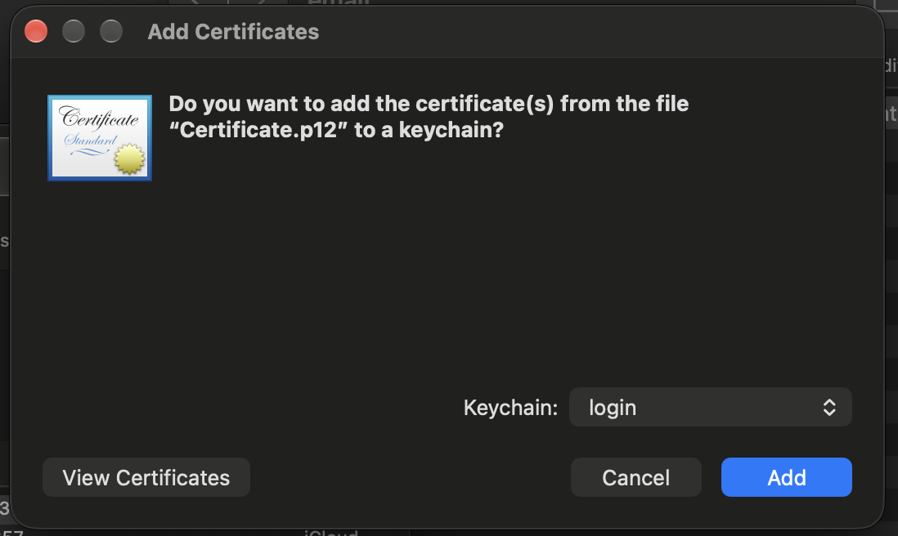
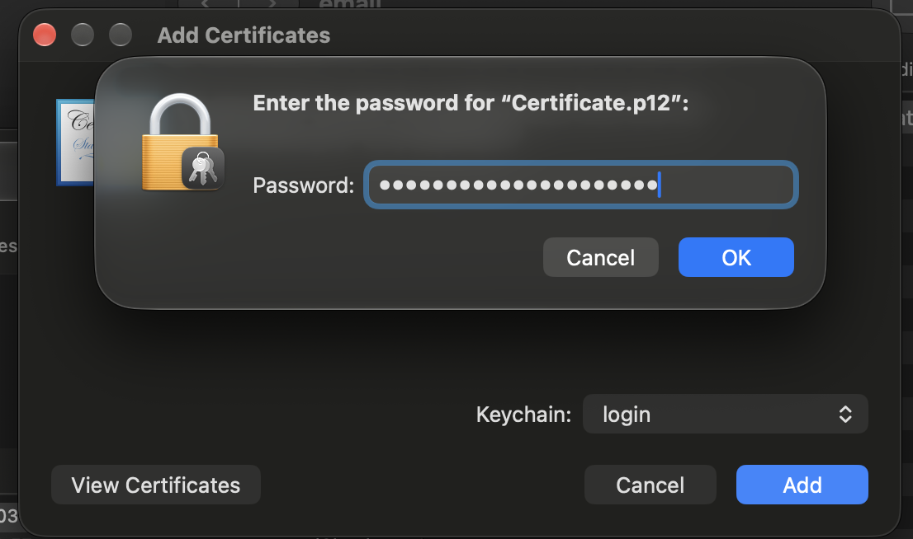

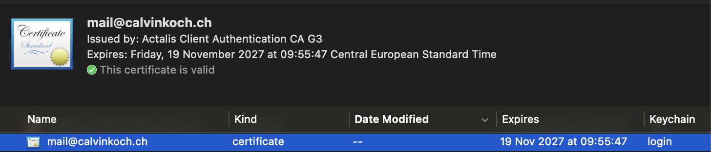
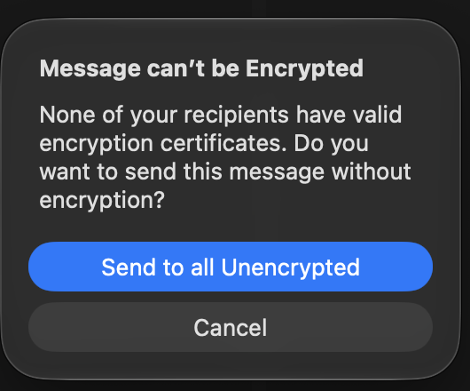
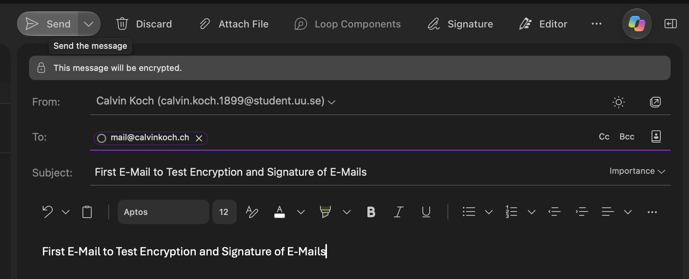
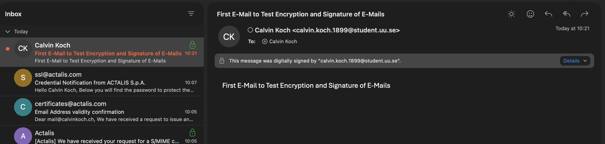
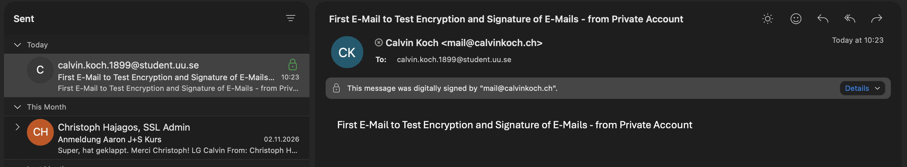
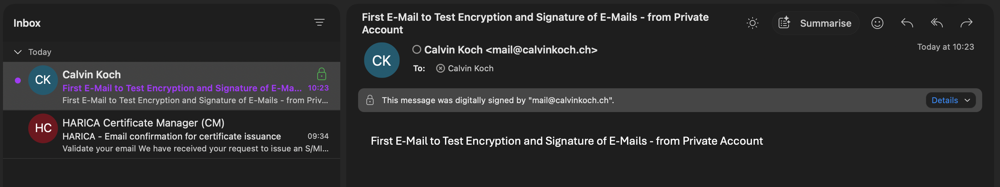
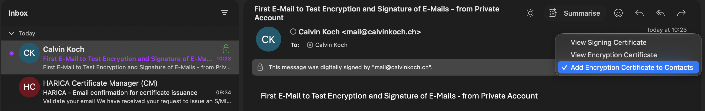
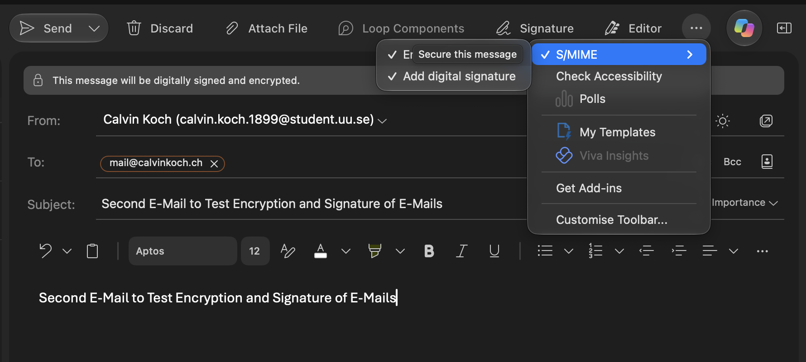
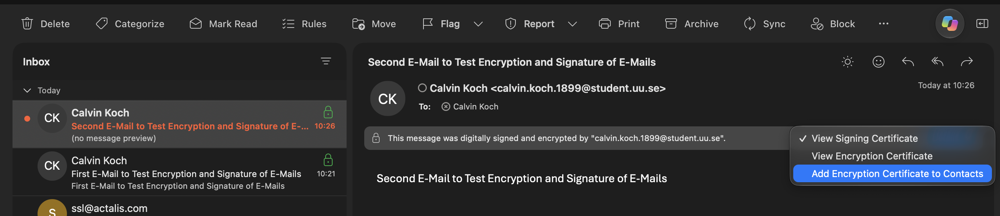
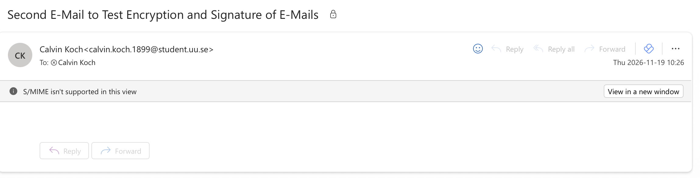

Before encrypted mail can be sent, the sender needs the recipient’s public
key. A signed email lets the recipient’s client receive and verify the
sender’s public certificate. After the keys have been exchanged, the clients
can encrypt messages for each other.

Thunderbird or another local mail client is more suitable than webmail because
the private key can stay on the local computer. With ordinary webmail, the
provider controls the page and may also control the key-handling process. This
makes it harder to guarantee end-to-end encryption.

**Encrypting Emails works similar/ the exact same as end to end encryption based on (insert the correct formulation here) an algorithm from prime numbers. Its computationally very easy to encrypt a message using the public key, but to decrypt easily you need the public key. You can also decrypt brute force but with todays computational power you will need forever to figure it out (find an estimate) and give a common source for the information in this section.

## Task 4: Access Control (TOCTTOU)

### 4.1 TOCTTOU Python Script (Exercises 1–4)

The short program is in [`tocttou.py`](tocttou.py). It opens a file for **only reference tocttou_auto_script.sh
writing, pauses, writes through the already-open file object, closes it, and
reports errors.

The automated test script is in
[`tocttou_auto_script.sh`](tocttou_auto_script.sh). In the normal test the
file was written successfully. When permissions were changed during the
pause, the already-open descriptor could still be used. When the file was
deleted during the pause, the open file could still be written, but the
directory entry was gone, so the file could not be found afterwards.

**Combine sections 4.1 and 4.2 into a single section and clearly and thoroughly go through the differences in the screenshots from the terminals, also order them as needed. Describe what each test did step by step first and then explain what the results were in the terminal. Also describe the script almost line by line in plain english in a separate section.

### 4.2 Cross-OS Replication (Exercises 5–8)

I tested the behaviour on macOS and Windows 11:

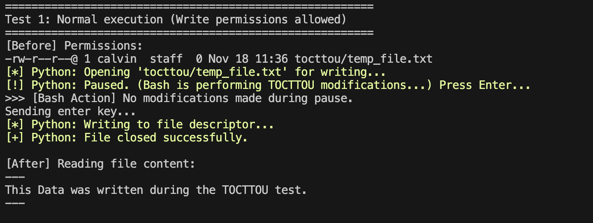
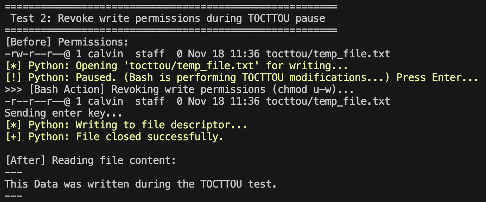
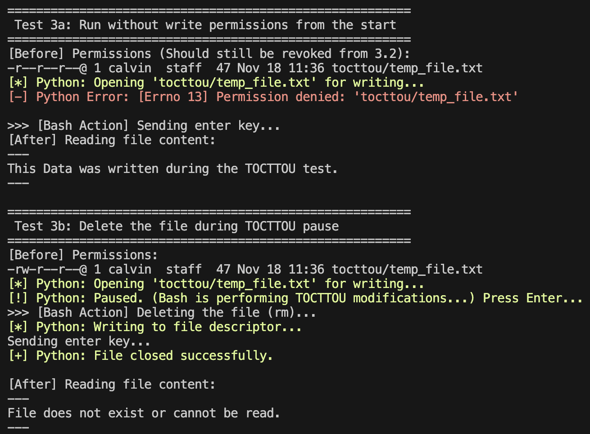
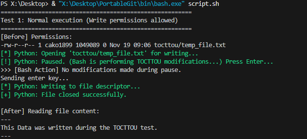
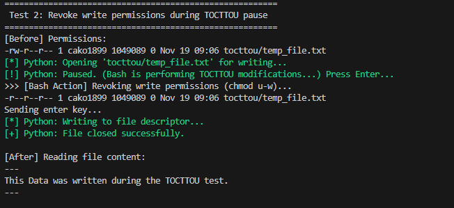
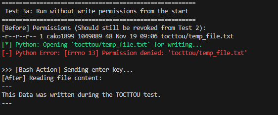
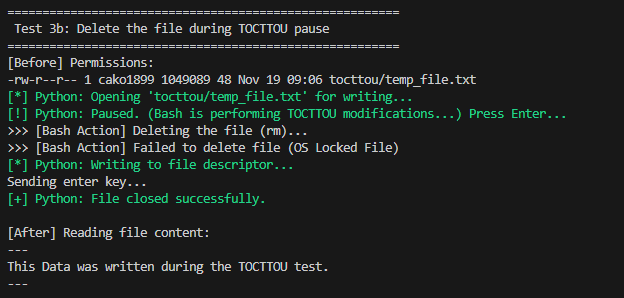

On Unix-like systems, deleting a file removes its directory name, but an
already-open file descriptor can continue to refer to the file data. Windows
uses different sharing and locking rules, so deletion or later access can
fail instead. This is why the same program can produce different output on
the two systems.

## References

See [`references.md`](references.md) for the source quotations and URLs.
** include the references by making use of the automatic refs.bib file.
