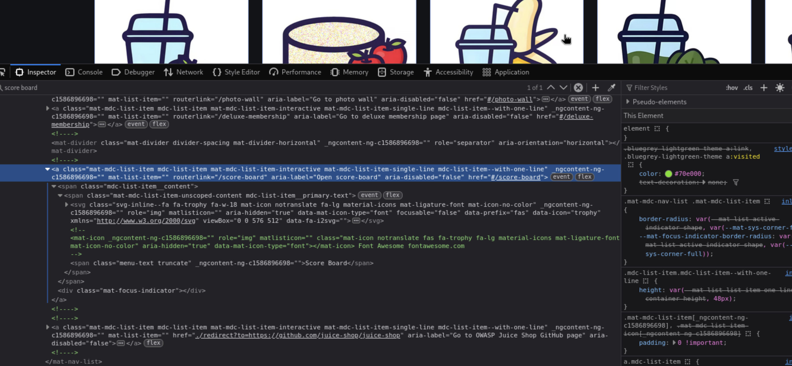
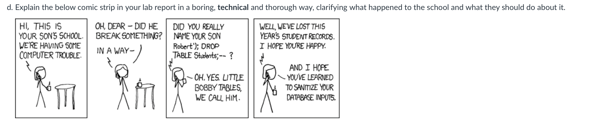

# Lab 1: Secure Computing

**Author:** Calvin Koch
**Date:** YYYY-MM-DD

---

Score Board find via search "score board" in source code of website

## Task 1: SQL Injections

### 1.1 Basic SQL Injection (Exercise 1)

* **Target Field:** Login
* **Injection Payload:** admin@juice-sh.op' or 1=1--
* **Resulting Output:** I was logged in as the administrator becuase we skipped the password verifaction step by providing a statement that is true in any case and commenting out the following statement which would have been the password verification.
* **kali**
* **Technical Explanation:**
  * **What is SQLi:** SQL Injection basically is code that is excecuted from a field you can enter something into a website. The backend parses the staments you provide instead of parsing
  * **Backend Query Mechanics:** The injection puts a statement that is always true and then comments out the following statements so it never checks the password

### 1.2 Authentication Bypass (Exercise 2)

* **Target User:** admin@juice-sh.op
* **Injection Payload:** admin@juice-sh.op' or 1=1--
  and any password
* **Result:** Successfully logged in as admin.
* **Target Field:** Login
* **Injection Payload:** ' or 1=1-- for login field
* **Resulting Output:** I was logged in as the administrator becuase we skipped the password verifaction step by providing a statement that is true in any case and commenting out the following statement which would have been the password verification.
* **Technical Explanation:**
  * **What is SQLi:** SQL Injection basically is code that is excecuted from a field you can enter something into a website. The backend parses the staments you provide instead of parsing
  * **Backend Query Mechanics:** The injection puts a statement that is always true and then comments out the following statements so it never checks the password

This works for any user: 'or 1=1 and email like('%user%');--

Just replace user with any keyword that works, you can also bruteforce find users. It will return an error otherwise.

### 1.3 Prevention Strategies (Exercise 3)

* **Administrator Actions:** [Explain parameterized queries/prepared statements, input validation, and ORM usage.]

Sanitize the textfields before you perform SQL searches.

### 1.4 "Little Bobby Tables" Comic Analysis (Exercise 4)



Bobby's full name looks like an SQL injection which deleted the tables from the schools database.

* **Incident Breakdown:** [Technically explain the DROP TABLE payload in the comic.]
* **Remediation for the School:** [What specific database hygiene practices the school failed to implement and how to fix them.]

### 1.5 Hash Extraction & Cracking [Higher Grades] (Exercise 6)

* **Extracted Data:**
  * *[User 1]*: `[Hash]` -> `[Cleartext Password]`
  * *[User 2]*: `[Hash]` -> `[Cleartext Password]`
* **Hashing Algorithm Identified:** [e.g., MD5, SHA-256, bcrypt]
* **Security Improvements:**
  1. [e.g., Salting]
  2. [e.g., Key stretching / stronger algorithms like Argon2]

### 1.6 Automated Exploitation with sqlmap [Higher Grades] (Exercises 7–9)

* **Tool Overview:** [What sqlmap does and how it determines vulnerabilities.]
* **Attack Mechanics:** [How the tool arrives at the query, how your input is used, and your step-by-step solution.]
* **Parameter Breakdown:**
  * `--ignore-code 401`: [Explanation]
  * `--technique=U`: [Explanation (Union-based)]
  * `--dbms=sqlite`: [Explanation]
  * `--dump`: [Explanation]

---

## Task 2: XSS/CSRF

Attack: 

```html
<iframe srcdoc="
    <h1>This is XSS injection Attack</h1>
    <p>This is inside the iframe.</p>
    <script>
        let email = localStorage.getItem('email');
        console.log('User email:', email);
    </script>
    <p> This is the users email: <span id='user-email'></span></p>
    <script>
        document.getElementById('user-email').textContent = email;
    </script>
"></iframe>
```

"2.1 Cross-Site Scripting (Exercises 1–3)

* **Attack Type:** [e.g., Stored XSS, Reflected XSS]
* **Step-by-Step Replication:**
  1. [Step 1]
  2. [Step 2]
* **Mechanism of Action:** [Explain how the script is injected, stored/reflected, and executed in the victim's browser. Detail the non-trivial impact, e.g., cookie exfiltration.]

### 2.2 XSS vs. CSRF Conceptual Differences (Exercises 4–5)

* **Trust vs. Deception:** [Explain that XSS exploits the user's trust in a malicious site/script, while CSRF exploits a site's trust in a user's authenticated browser session.]

The conceptual difference between XSS and CSRF boils down to the direction of trust and who is being deceived.

In your lab report, you can frame the difference exactly like this:

* **XSS (Cross-Site Scripting) exploits the *user's trust in the website*.** The user visits a legitimate site, trusting that the site is safe. However, the site has been deceived into serving malicious JavaScript. The user's browser executes this script because it assumes the trusted website put it there.
* **CSRF (Cross-Site Request Forgery) exploits the *website's trust in the user's browser*.** The website receives a command and sees a valid, authenticated session cookie attached to it. The website trusts the request and executes it, completely unaware that a different, malicious website tricked the user's browser into sending that command.

Here are conceptual examples of how these attacks play out in educational environments like Juice Shop or web security courses.

### Conceptual Example: XSS (The Malicious Review)

Imagine an e-commerce site that allows users to leave product reviews.

1. **The Setup:** The site does not sanitize user input. An attacker writes a product review, but instead of text, they type in a JavaScript payload designed to steal session cookies. The database saves this script exactly as written.
2. **The Execution:** You (the victim) log into the site and click on that product to read the reviews.
3. **The Result:** The server pulls the reviews from the database and sends them to your browser. Your browser sees the attacker's script mixed in with the HTML, assumes it is a legitimate part of the website's programming, and executes it.
4. **The Deception:** The script silently reads your session cookie and sends it to the attacker's server. You are deceived because you trusted the website, but the website handed you a loaded weapon.

### Conceptual Example: CSRF (The Hidden Form)

Imagine the same e-commerce site has a feature to change your account email address. The form submits a `POST` request to `[https://shop.com/api/change-email](https://shop.com/api/change-email)` with the new email address.

1. **The Setup:** The attacker creates a completely separate, malicious website—let's say a blog about cute cats. On this blog, they hide an invisible web form that is pre-filled with the attacker's email address and programmed to automatically submit a `POST` request to `[https://shop.com/api/change-email](https://shop.com/api/change-email)` as soon as the page loads.
2. **The Execution:** You log into the e-commerce site to do some shopping. In another tab, you click a link sent by the attacker to view the cute cat blog.
3. **The Result:** The cat blog silently submits the hidden form to the e-commerce site. Because you are actively logged into the e-commerce site in another tab, your browser automatically attaches your authentication cookies to this background request.
4. **The Deception:** The e-commerce server receives the request, checks the cookie, confirms it is you, and changes the email address to the attacker's email. The website is deceived because it blindly trusted the browser's cookie, not realizing the browser was manipulated by a third-party tab.

### 2.3 Protection Ramifications & Mitigation [Higher Grades] (Exercise 6)

* **Scenario A (XSS protected, CSRF vulnerable):** [Concrete example of impact.]
* **Scenario B (CSRF protected, XSS vulnerable):** [Concrete example of impact.]
* **Combined Protection Scheme:** [Propose a unified defense, e.g., Anti-CSRF tokens + Content Security Policy (CSP) + input/output sanitization, and explain why it works.]

---

## Task 3: Authentication

### 3.1 XKCD Password Generator (Exercises 1–10)

* **Source Code:** [Link to file or insert Python code block]
* **Example Output:**

  ```text
  [Paste terminal output here, matching the requested format with entropy and random character equivalents]
  ```
* **Explanation:** [Briefly explain how the script calculates entropy based on wordlist size.]

### 3.2 Shoulder Surfing Entropy (Exercises 11–13)

* **Assumptions:** [e.g., Keyboard layout, visual angles, known lengths.]
* **Calculations:** [Step-by-step math for calculating the remaining entropy of 10 keystrokes with 3 known shift presses.]

### 3.3 S/MIME Secure Email (Exercises 14–18)

* **Certificate Details:**
* **Issuer:** [e.g., Sectigo, Let's Encrypt, UU IT]
* **Validity Period:** [Dates]
* **Encryption vs. Signing Order:** [Explain why public keys must be exchanged via a signed email before encrypted communication can commence.]
* **Mail Client vs. Webmail:** [Explain key management, local private key storage, and why browser-based webmail fundamentally compromises end-to-end encryption.]

### 3.4 Password Policy Analysis [Higher Grades] (Exercises 19–24)

* **Information Theory Minimum Length:** [Calculation for minimum length of allowed passwords to hit 27 bits of entropy.]
* **NIST 10-Symbol Discrepancy:** [Explain why the UU policy differs from the calculation, referencing NIST 800-63-2 regarding human behavior and password predictability.]
* **Entropy Comparison (n vs 2n):** [Mathematical comparison for an alphabet of size 62.]
* **Brute Force Time Estimation:** [Calculation based on 1000 guesses per second.]

---

## Task 4: Access Control (TOCTTOU)

### 4.1 TOCTTOU Python Script (Exercises 1–4)

* **Source Code:**

```python
# Insert your <50 line Python script here
```

* **Test Results & Permissions:**
* **Test 1 (Standard Run):** [Printouts + `ls -l` before and after]
* **Test 2 (Permissions Removed):** [Printouts + `ls -l` before and after]
* **Test 3 (File Deleted):** [Printouts + `ls -l` before and after]
* **Analysis of Results:** [Explain the race condition and how the OS access controls evaluated the file descriptors at check time vs. use time.]

### 4.2 Cross-OS Replication (Exercises 5–8)

* **Operating Systems Tested:** [e.g., macOS Unix vs. Windows 11]
* **Behavioral Differences:** [Explain differences in file locking mechanisms, e.g., Windows locking the file upon open vs. Linux allowing deletion of inodes.]

### 4.3 Design Principles Analysis [Higher Grades] (Exercises 9–11)

* **Violated Principles:** [Reference specific Saltzer and Schroeder principles, likely *Fail-safe defaults* or *Complete mediation*.]
* **Reasoning:** [Why the OS design fails these principles in this context.]
* **Proposed Fixes & Trade-offs:** [Suggest atomic operations or file locking, and balance the performance overhead vs. security benefits.]

---

## References

1. [Insert Citations Here]

### Formatting & Citation Guidelines

For computer security reports at Swedish universities (like Uppsala), the standard citation style is **IEEE**.

* Number your citations in brackets (e.g., `[1]`) in the text.
* List them numerically in the References section at the bottom.
* Include the OWASP Wiki, the NIST publication, and the Saltzer & Schroeder paper exactly as they are referenced in the prompt.

Your lab instructions end with: *"Ensure that you comply with our rules for format and style of your hand-in."* Do you have that specific rules document available, or should we just proceed with the standard academic layout provided above?
